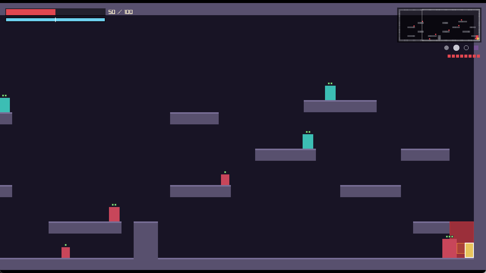
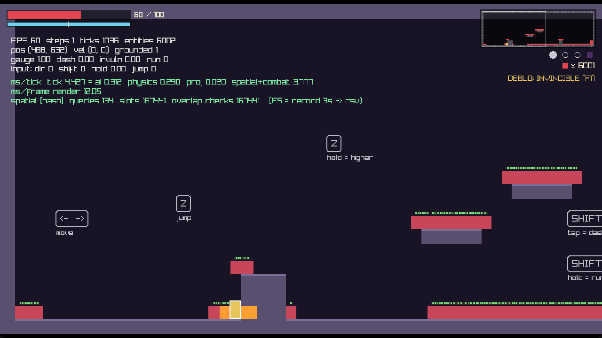
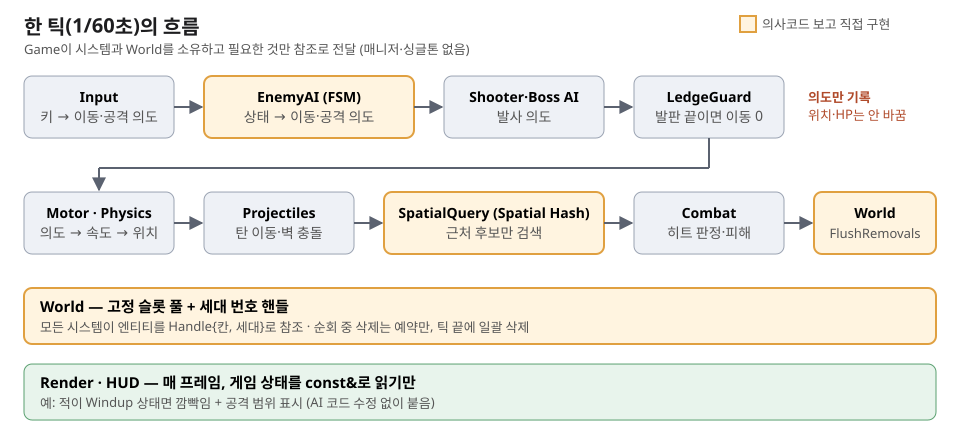
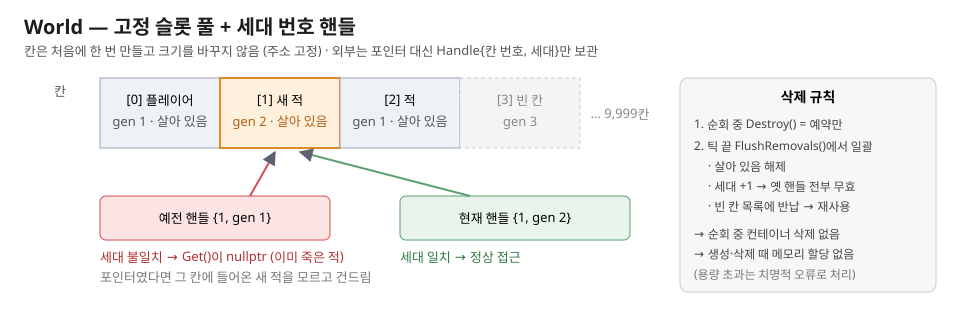
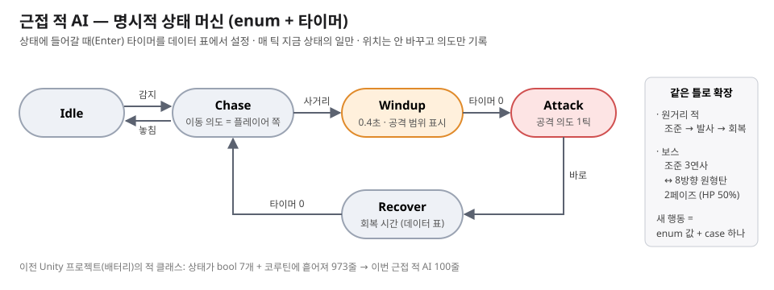
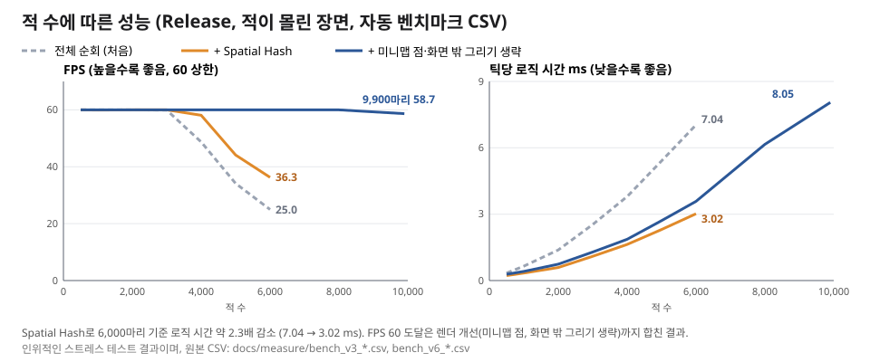

# C++ 2D 룸 클리어 액션 (프로토타입, 이름 미정)

C++20 + raylib로 4일(2026-11-16 ~ 11-19) 동안 만든 2D 횡스크롤 근접 액션 게임입니다.
**AI(Claude)가 주로 구현하고, 개발자가 설계 결정·검증과 핵심 구조 일부를 맡는 방식**으로 진행했습니다. 누가 무엇을 했는지는 파일 이름과 [개발 기록](docs/devlog.md)에 남겼습니다.

> 그래픽·사운드 리소스는 아직 적용하지 않았습니다 (색 사각형, 코드로 합성한 효과음).
> 결과물보다 **구조 설계, C++ 수명 관리, 측정으로 검증한 최적화, AI 협업 과정**을 보여주는 것이 목적입니다.

| 방 1 (근접·원거리 적, 발판) | 스트레스 테스트: 적 6,000마리 + 디버그 패널, 60 FPS |
|---|---|
|  |  |

---

## 한눈에 보기
| | |
|---|---|
| 구성 | 튜토리얼 → 방 1 → 방 2 → 보스방. 적 3종(근접 / 원거리 / 2페이즈 보스), 아이템 5종 |
| 기술 | C++20, raylib, CMake + Visual Studio 2022, doctest |
| 핵심 | 세대 번호 핸들 풀 · 명시적 FSM · Spatial Hash · 고정 타임스텝 · 매니저/싱글톤 없는 책임 분리 |
| 성능 | 적 6,000마리 25 → 60 FPS, 최대 9,900마리 58.7 FPS (자동 벤치마크 CSV로 전후 비교) |
| 직접 구현 | 의사코드를 보고 직접 구현: World(핸들 풀), Spatial Hash, 근접 적 AI(FSM), Stats |

## 조작
`← →` 이동 · `Z` 점프(길게 = 높이) · `X` 공격 · `Shift` 짧게 = 대시(무적) / 길게 = 달리기
`F1` 디버그 패널 + 무적 · `F2` / `F4` 적 1 / 100마리 추가 · `F3` 전체 순회 ↔ 해시 전환 · `F5` 3초 측정 → CSV

---

## 설계

### 한 틱의 흐름


- **고정 타임스텝**: Unity `FixedUpdate`를 직접 구현한 것. 프레임 시간을 누적했다가 1/60초씩 꺼내 로직을 돌립니다. 물리뿐 아니라 AI·전투 등 게임 로직 전부가 고정 틱에서 돌고, 그리기는 매 프레임 따로 합니다. 히트스톱도 "틱 건너뛰기"로 구현했습니다.
- **의도(Intent) 분리**: 입력과 AI는 "하고 싶은 것"만 기록하고, 위치·HP는 Motor·Physics·Combat만 바꿉니다.
- **Render는 읽기 전용**: 게임 상태를 `const&`로만 받습니다.

### World — 세대 번호 핸들 ([World_U.h](src/core/World_U.h))


```cpp
Entity* World::Get(Handle hTarget)
{
    if (hTarget.uIndex >= kCapacity)
        return nullptr;
    Slot& tSlot = m_vecSlots[hTarget.uIndex];
    // 세대가 다르면 = 이미 죽은 적 (그 칸은 다른 적이 쓰는 중일 수 있음)
    return (tSlot.bAlive && tSlot.uGen == hTarget.uGen) ? &tSlot.tValue : nullptr;
}
```

### 근접 적 AI — 명시적 FSM ([EnemyAI_U.cpp](src/systems/EnemyAI_U.cpp))


이전 Unity 팀 프로젝트의 적 클래스는 상태가 bool 7개와 코루틴에 흩어져 있었습니다(973줄). 이번에는 `enum class` + 상태 진입(`Enter`) + 타이머로 나눠 근접 적 AI가 100줄이 되었고, 같은 틀로 원거리 적과 보스까지 확장했습니다.

---

## 성능 — Spatial Hash ([SpatialHash_U.cpp](src/systems/SpatialHash_U.cpp))


| 6,000마리 몰림 | FPS | 틱당 로직 |
|---|---|---|
| 전체 순회 (처음) | 25.0 | 7.04 ms |
| + Spatial Hash | 36.3 | 3.02 ms |
| + 미니맵 점·화면 밖 그리기 생략 | 60 (상한) | 3.58 ms |
| → 9,900마리 | 58.7 | 8.05 ms |

- `SpatialQuery`가 전체 순회와 해시를 같은 인터페이스로 감싸고, 테스트로 **두 방식의 결과가 순서까지 같은지** 확인합니다. `F3`으로 실행 중에 바꿔 비교할 수 있습니다.
- 측정은 `Main.exe --bench`(적 수를 500 → 9,900마리까지 자동으로 늘리며 3초씩 평균)로 같은 조건을 반복했습니다. 원본: [docs/measure/](docs/measure/), 과정: [measure.md](docs/design/measure.md)
- **예측과 실제**: 구현 전에 AI가 "로직 5~8배 향상"을 예측 → 실제 2.3~2.6배. 칸 크기 실험(32/64/128/256)으로 원인이 "적이 한 자리에 수백 마리 겹쳐 쌓이는 것"임을 확인했습니다.
- 인위적인 스트레스 테스트 결과입니다. 남은 비용은 겹친 적끼리의 판정이고, 진영별 검색 분리와 적끼리 밀어내기가 다음 단계입니다.

---

## AI 협업 방식
- **역할**: Claude = 주 개발 / Codex(GPT) = 의사코드·코드 교차 검수, C++ 학습 보조 / 개발자 = 설계 결정, 핵심 구조 구현, 플레이 검증, 최종 판단
- **순서**: 기능마다 의사코드 먼저 합의([docs/design/](docs/design/)) → 구현 → 빌드(경고 0, `/W4` + AddressSanitizer)·테스트 → 개발자 플레이 확인 → 커밋
- **작성자 표시**: 파일 이름 접미사 `_U` = 개발자 / `_C` = AI / 접미사 없음 = 혼합(구역별 주석). 목록은 [code-guide.md](docs/code-guide.md)
- **기록**: [devlog.md](docs/devlog.md)에 날짜별로 "AI가 제안한 것 / 개발자가 고치거나 거절한 것과 이유"

| 사례 | 내용 |
|---|---|
| 예측 검증 | AI의 성능 예측을 측정으로 확인, 빗나간 원인을 실험으로 찾음 |
| 제안 거절 | "누르는 순간 대시" 제안을 원래 의도(짧게 = 대시 / 길게 = 달리기)와 달라 거절 |
| 교차 검수 | Codex 리뷰가 개발자 코드(Stats)에서 테스트로 못 잡던 버그 2건 발견 |
| 플레이 검증 | "적이 발판에서 바로 뛰어내린다"는 문제를 플레이로 발견 → 적 AI는 그대로 두고 이동 직전 필터(LedgeGuard) 추가 |
| AI 실수 기록 | AI가 빌드 설정 파일 인코딩을 깨뜨림 → 원본으로 복구, 재발 방지 규칙 기록 |

---

## 빌드
Windows, Visual Studio 2022, CMake. raylib와 doctest는 `FetchContent`로 받습니다.
```
cmake -S . -B build
cmake --build build --config Release
build\bin\Release\Main.exe
```
테스트: `cmake --build build --config Debug` 후 `ctest --test-dir build -C Debug` (125개)

## 폴더
```
src/core      Game, World(핸들 풀), 고정 타임스텝, 측정(Profiler·Bench)
src/systems   Input, PlayerMotor, Physics, Combat, EnemyAI(FSM), ShooterAI, BossAI, SpatialHash, Stats, Items, RoomFlow
src/render    Render, HUD, 카메라
src/audio     효과음 합성·재생 (RAII)
src/data      적·아이템·방 데이터 표
docs/         GDD, design(기능별 의사코드), devlog, measure(CSV)
```
